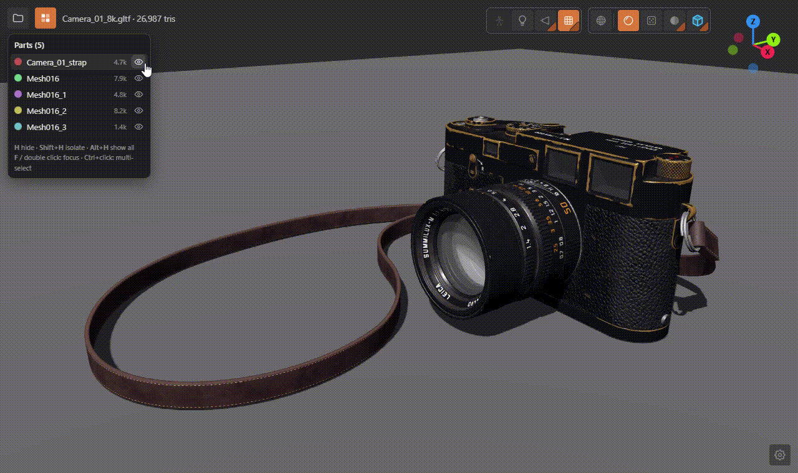
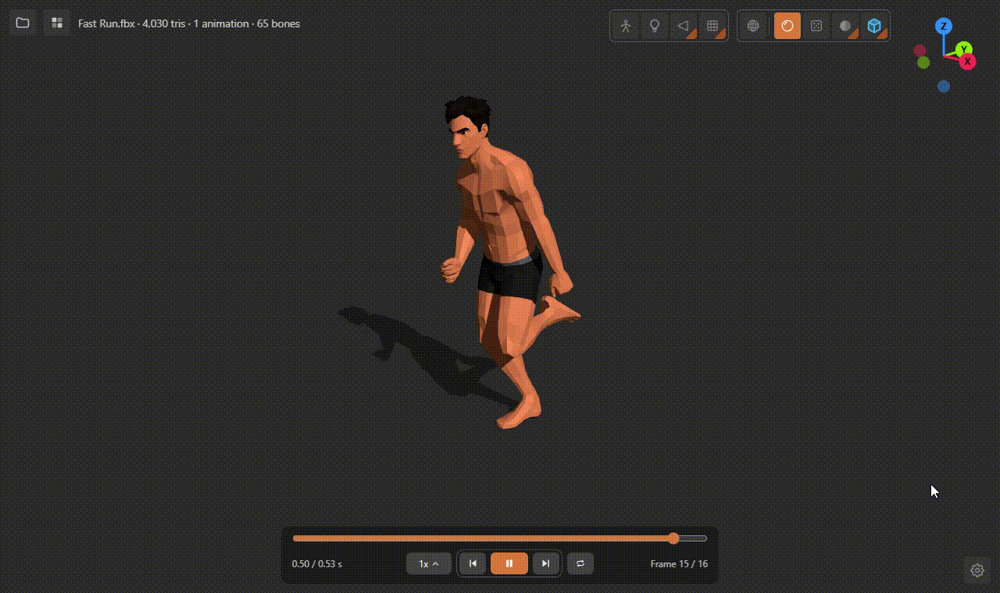

# PolyPeek3D



[English](README.md) | [Türkçe](README-TR.md)

A small, fast 3D model viewer for Windows. No server, no browser, no account.

**Supported formats:** FBX · GLB/GLTF · OBJ · STL · PLY · DAE · 3DS · 3MF · AMF · STEP/STP

## Features
- Four shading modes: Material, Random colours, Solid and Hologram. Wireframe can be turned on over any of them.
- Part list: select parts, hide them, isolate them or fly the camera to them.
- STEP/STP support: CAD models open with their colours and parts, with adjustable detail.
- Animation playback: speed control, loop modes and a timeline.
- Light, shadow, floor and camera settings.

## Animation


## Install
Download from the **Releases** page:
- **`PolyPeek3D-Setup-x.y.z.exe`:** Installer. Needs no admin rights and sets up the file associations.
- **`PolyPeek3D-x.y.z-portable.zip`:** Portable version. Unzip it anywhere. Run `Associate-Files.bat` if you want models to open with a double-click.

**Requirements:** Windows 10/11 (64-bit) and the Microsoft Edge WebView2 Runtime. WebView2 comes with Windows 11; otherwise you can get it [here](https://go.microsoft.com/fwlink/p/?LinkId=2124703).

> The installer is not digitally signed, so Windows SmartScreen may show a warning. Click "More info" > "Run anyway" to continue.

## Usage
- Double-click a model, drag and drop it onto the window, or use the folder button at the top left.
- Left-drag rotates, right-drag pans, the wheel zooms. Double-click empty space to fit the model to the window.
- Buttons with a ◢ mark in their bottom-right corner have their own settings panel. Click that corner or right-click the button to open it.
- Textures and `.mtl` / `.bin` files are read automatically from the model's folder. When you drag and drop, drop them together with the model.

| Shortcut | Action |
|---|---|
| `H` | Hide selected parts |
| `Shift + H` | Show only the selected parts |
| `Alt + H` | Show all |
| `F` | Focus on selected parts |
| `Ctrl + left-click` | Select multiple parts |

## Uninstall
Uninstall from Windows Settings > Apps. Everything is removed, settings included.
For the portable version, run `Remove-Associations.bat` and delete the folder.

## Build from source
```
winget install Microsoft.DotNet.SDK.8
winget install JRSoftware.InnoSetup
build-release.bat
```
The output goes to the `release\` folder. The version number is kept in the `VERSION` file.

## License
MIT, see [LICENSE](LICENSE). Third-party components: [THIRD-PARTY-NOTICES.txt](THIRD-PARTY-NOTICES.txt).
